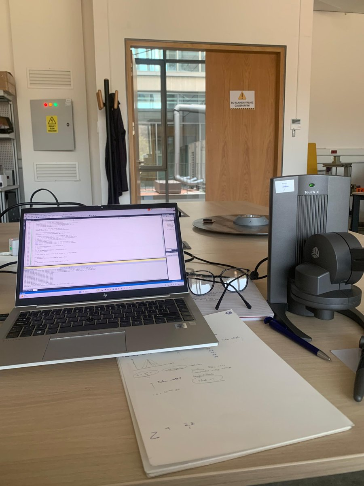
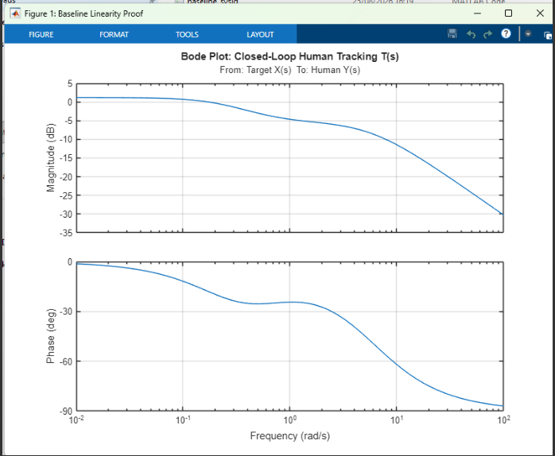
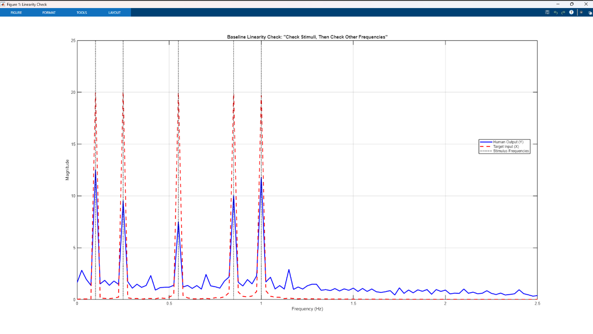
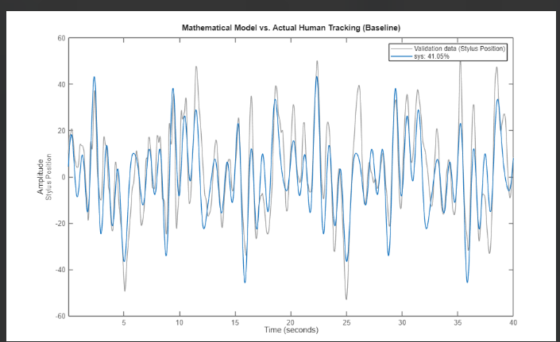
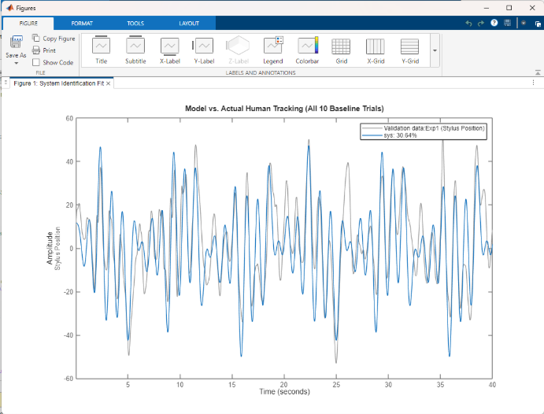
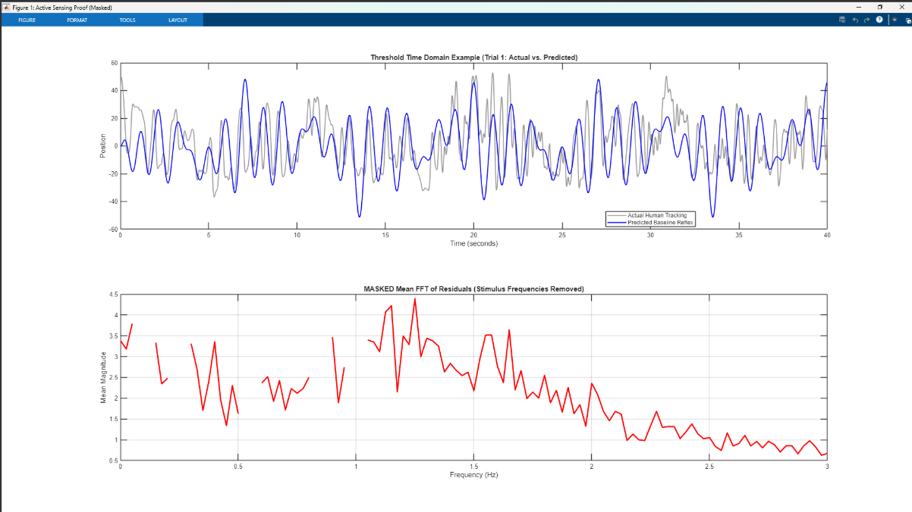

# Active Sensing in Human Visual-Motor Tracking

Touch X experiments and MATLAB analysis, built during a research internship at METU ROMER (Middle East Technical University, Center for Robotics and Artificial Intelligence).

  

<em>The bench: Touch X, the experiment code open in Visual Studio, and working notes on the visibility rule.</em>

Weakly electric fish keep a refuge in view by swaying back and forth. When their sensory signal gets worse they sway more, because motion relative to the object is what makes it observable (Karagoz et al. 2025). This project asks whether people do the same. A participant follows a moving target with a Touch X stylus. The target is only visible when the stylus and the target move relative to each other, so tracking it perfectly makes it disappear.

## Experiment in one paragraph

The target moves as a sum of five sines (0.1, 0.25, 0.55, 0.85 and 1.0 Hz) with a random phase for each component on every trial. There are three conditions. In **baseline** the target is always visible. In **threshold** it is either fully visible or gone, decided by the relative velocity through the rule V = (a|v_q|)^n with a two-level hysteresis gate. In **continuous** it fades smoothly with the same V. Each participant did ten 60 s trials per condition, and six participants took part.

## Pipeline in one paragraph

Baseline tracking is fitted with a 2nd-order state-space model, which acts as a linear stand-in for the participant when the target is clearly visible. Feeding the threshold and continuous targets through that model predicts what normal tracking would look like. Whatever the participant did beyond that prediction, away from the five target frequencies, is the signature of active sensing. A kernel two-sample test (maximum mean discrepancy) asks whether the spectra differ from baseline by more than chance.

## Repository layout

| Folder | Contents |
|---|---|
| `haptics/exp1_target_tracking/` | Visual Studio source for the three-condition experiment, `main.cpp` |
| `haptics/exp2_error_only_feedback/` | Error-bar variant where only the tracking error is shown |
| `haptics/archive/` | Earlier pilot version, flashlight variant |
| `haptics/sandbox_ghost_object/` | Two small haptic fading demos |
| `analysis/matlab/` | Analysis scripts `s01` to `s08`, shared functions in `lib/`, settings in `config_study.m` |
| `analysis/matlab/pilot/` | Pilot tracking-error ANOVA |
| `docs/` | Experiment design, analysis pipeline, results, project history, build help, provenance |
| `data/` | Where raw CSVs go, not committed |
| `figures/`, `results/` | Output of the scripts |
| `third_party/` | Where the authors' MMD functions go, see its README |

## Run it

**Collect data.** Open `haptics/exp1_target_tracking/main.cpp` in a Visual Studio project linked to OpenHaptics 3.5.0, set `CONDITION`, `PARTICIPANT_ID` and `CURRENT_TRIAL` at the top, and build. Setup steps are in [`haptics/README.md`](haptics/README.md).

**Analyse.** Put the CSVs in `data/raw/` (see [`data/README.md`](data/README.md)), set the current folder in MATLAB to `analysis/matlab`, and run

    run_participant('P1')    % one participant, all steps
    run_all                  % every participant and the group summary

MATLAB R2020a or newer, with the System Identification, Signal Processing and Statistics toolboxes.

| Script | Output |
|---|---|
| `s01_mean_fft_ci` | Mean spectra of human and target in all conditions with 95 percent bootstrap intervals |
| `s02_remnant_power` | Power away from the target frequencies, per trial, with a boxplot |
| `s03_baseline_sysid` | State-space model of baseline tracking, single trial and all trials, with fit percentages |
| `s04_residual_fft` | Spectrum of what the baseline model cannot explain, target frequencies removed |
| `s05_closed_loop_tf` | Transfer function T(s), poles, Bode plot, linearity check, predicted against actual spectrum |
| `s06_mmd_test` | MMD permutation test between two conditions |
| `s07_exploratory_fish_plant_controller` | Controller C(s) under a borrowed fish plant, exploratory only |
| `s08_group_remnant_stats` | Remnant power across participants with a Friedman test |

## What was found

Details and numbers are in [`docs/RESULTS.md`](docs/RESULTS.md). In short, with the target always visible the participant's output sits on the five target frequencies and a stable, overdamped low-order linear model captures its gain and phase. In the threshold condition the residual has a broad band of raised power around 1.1 to 1.7 Hz (highest near 1.25 Hz), above every frequency that was on the screen, and the linear baseline model does not produce it. A permutation test separates the baseline and threshold spectra with p < 1e-4. The worked example is the first participant.

### Figures

| | |
|---|---|
|  |  |
| Bode plot of the baseline closed-loop model T(s): overdamped low-pass, no resonance. | Baseline linearity check: output power sits at the stimulus frequencies. |
|  |  |
| 2nd-order fit to one baseline trial, 41.05 %. | Merged ten-trial fit, 30.64 %. |

*Threshold trial: target and stylus in time (top) and the residual spectrum with the stimulus bands masked (bottom), showing a broad band of raised power around 1.1 to 1.7 Hz.*

## Limits

- The six participants are a pilot. The full model-based analysis was run in depth on the first participant.
- Ten trials per condition from one person are not independent samples of a population.
- The linear baseline model is an approximation. Its fit is moderate (41 percent for one trial, 31 percent for the merged ten), so the residual contains some unmodelled linear tracking as well as active sensing.
- The controller C(s) in `s07` uses the fish plant, not the participant's, and should be read as an exploration.

## References

- Karagoz, Kilic, Aydin, Ankarali, Uyanik. Predictive uncertainty in state estimation drives active sensing. Dataset and code: https://aperta.ulakbim.gov.tr/records/274062 (CC BY-SA 4.0).
- Kilic, A. METU visual tracking demo and thesis on visual-motor tracking, 2023, the starting point for the scene.
- 3D Systems. OpenHaptics Toolkit 3.5.0, QuickHaptics programmer's guide.

## Licence

MIT, see `LICENSE`. Third-party material keeps its own licence, see [`docs/CODE_PROVENANCE.md`](docs/CODE_PROVENANCE.md).
