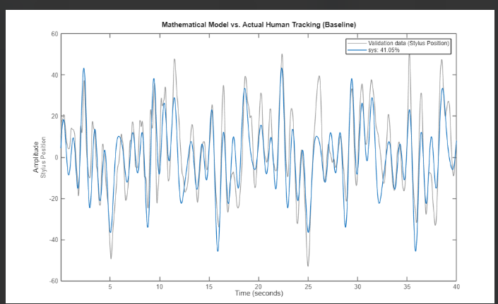
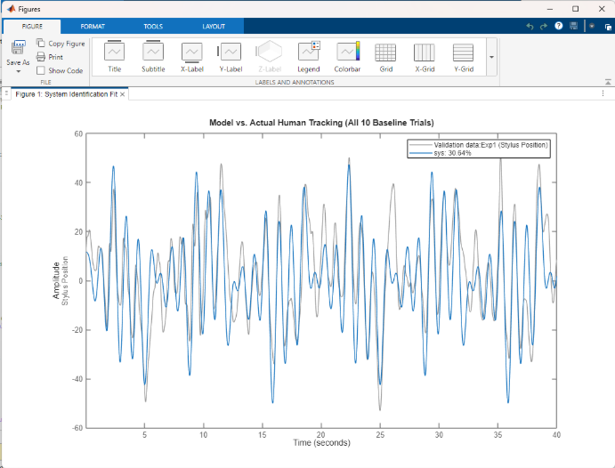
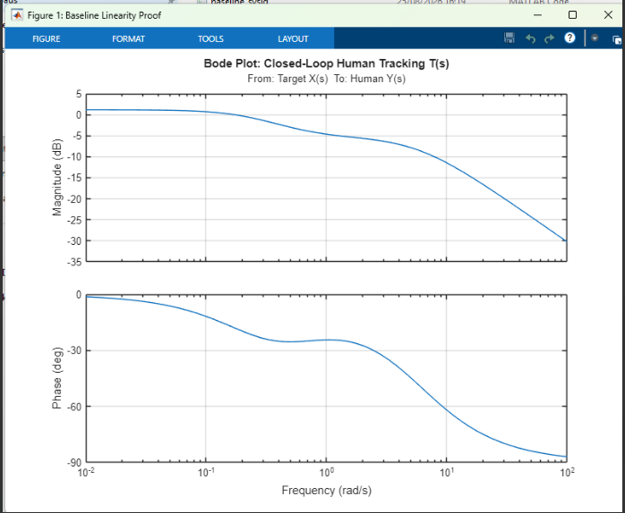
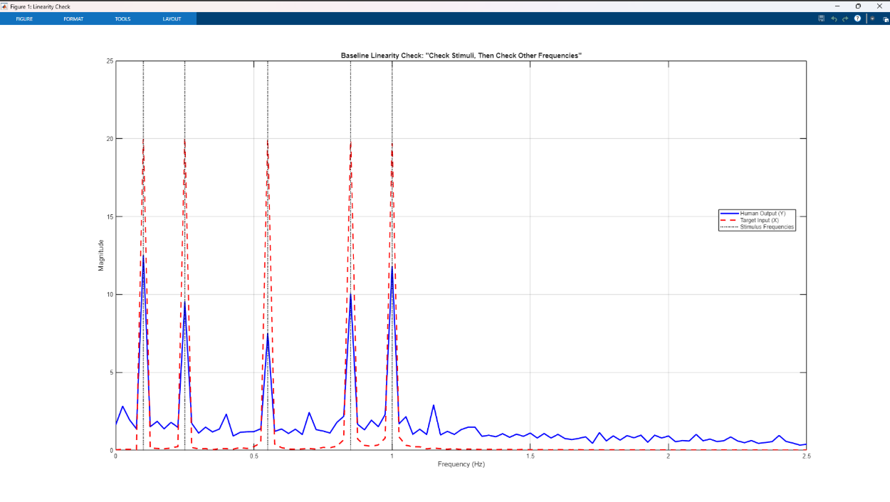
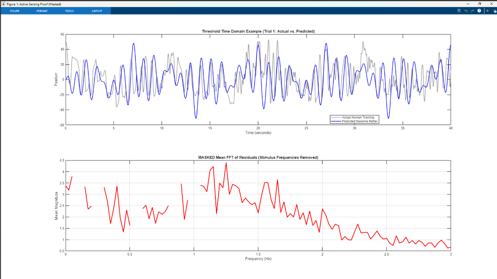

# Results

All numbers below are printed by the scripts in `analysis/matlab/`. The worked example is the first participant, ten trials per condition. Figures are written to `figures/` by the same scripts.

## 1. Spectra and remnant power

With the target always visible the participant's spectrum has peaks at the five target frequencies and little elsewhere (section 3). Remnant power, the energy away from those frequencies, is the measure of what the target did not ask for. In an earlier pilot dataset the mean remnant power was about 1.39 for baseline and 5.73 for threshold, roughly a fourfold increase.

## 2. Baseline model

2nd-order state-space model, target position to stylus position.

| Model | Fit |
|---|---|
| first baseline trial | 41.05 % |
| all ten baseline trials | 30.64 % |

*Left to right in the table above: first trial (41.05 %) and merged ten trials (30.64 %).*

Single-trial plant matrices

    A_f = [ -0.3154   5.8824
            -4.9315  -3.2716 ]
    B_f = [ 0.0013
            0.0023 ]

Universal plant matrices (ten trials)

    A_f = [ -3.8059  -6.8172
             6.6540   1.5838 ]
    B_f = [ 0.0001255
            0.0007282 ]

The fit is moderate. A linear model captures part of the tracking and leaves the rest, which is why the residual is read only away from the target frequencies.

## 3. Closed-loop human tracking, baseline

    T(s) = (3.0791 s + 1.7072) / (s^2 + 5.9724 s + 1.4888)
    poles  -5.7118 and -0.2606

Both poles are real and negative, so the model is stable and overdamped, with no resonance. The DC gain is 1.7072 / 1.4888 = 1.15. Evaluated at the stimulus frequencies

| Frequency | Gain | Phase |
|---|---|---|
| 0.10 Hz | 0.66 | -25 deg |
| 0.25 Hz | 0.54 | -25 deg |
| 0.55 Hz | 0.47 | -36 deg |
| 0.85 Hz | 0.40 | -46 deg |
| 1.00 Hz | 0.36 | -50 deg |

Gain falls with frequency, so baseline tracking behaves as a smooth, linear low-pass filter. The baseline human spectrum has peaks only at the five stimulus frequencies, which is what a linear response looks like.

## 4. Threshold, what the linear model misses

The first threshold trial's target is fed through the baseline model. The predicted spectrum has peaks only on the stimulus frequencies. The actual spectrum has large power between and above them. After the stimulus bands are removed, the mean residual shows a broad band of raised power from about 1.1 to 1.7 Hz, with its highest point near 1.25 Hz (magnitude about 4.4). The target has nothing above 1.0 Hz, and a linear system cannot make frequencies it did not receive. The residual is also raised at low frequencies (about 3.4 near 0.05 Hz and 0.4 Hz), so the high band is a broad bump and not an isolated line. It is the candidate active sensing signature, and a comparison of the same residual in baseline trials is what makes it conclusive.

## 5. Statistical test

MMD permutation test, baseline against threshold, first participant, 10 trials each, Gaussian kernel with sigma 1, 10,000 shuffles.

| Statistic | p |
|---|---|
| 2.548e-15 | below 1e-4 (no shuffle reached the observed value) |

## 6. Fish-plant reference (not a human result)

Borrowing the fish plant from the paper, P(s) = k / (m s^2 + b s) with m = 0.0025, b = 0.0269 and k = 0.2385, gives

    H(s) = (-0.2481 s + 12.5375) / (s^2 + 2.2222 s + 39.334)
    poles  -1.1111 +/- 6.1725 i

with gain and phase at 0.10, 0.55 and 1.00 Hz of (0.32, 357.23 deg), (0.44, 340.43 deg) and (0.90, 262.32 deg). These describe the fish plant, where the 1 Hz resonant peak lives. They are shown in the project as the reference system the paper works with, and are not measurements of a person.

Using that plant to back out a controller from the human T(s) gives

    C(s) = (0.0323 s^3 + 0.3652 s^2 + 0.1926 s) / (s^3 + 2.8933 s^2 - 0.2185 s)

The denominator has a root at +0.074, a right-half-plane pole, a sign that the borrowed plant does not describe the human. `s07` documents this as exploratory.

## 7. Pilot, exponent sweep

An earlier pilot with the threshold rule at n = 2, 4 and 6 plus a baseline (ten trials each) gave a one-way ANOVA on tracking RMSE of p = 1.86e-19. All three penalty levels differed from baseline in the multiple comparison. Velocity histograms widened with n and the 1.1 to 3.0 Hz band gained energy.

## Reading these results

- One participant carries the model-based analysis. Six took part.
- Trials within a participant are not independent samples of a population.
- The linear baseline model fits moderately, and the Bode and pole results apply to this participant's T(s).
- The p value shows the spectra differ. It does not say why. The explanation, that the wiggle reduces uncertainty about the target, comes from the paper's model and was not tested here.
